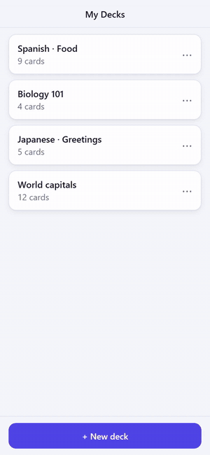
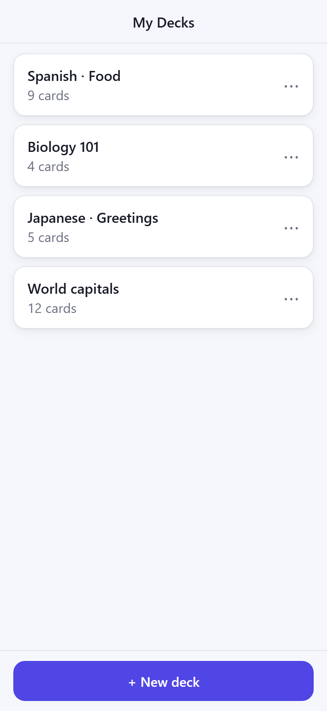
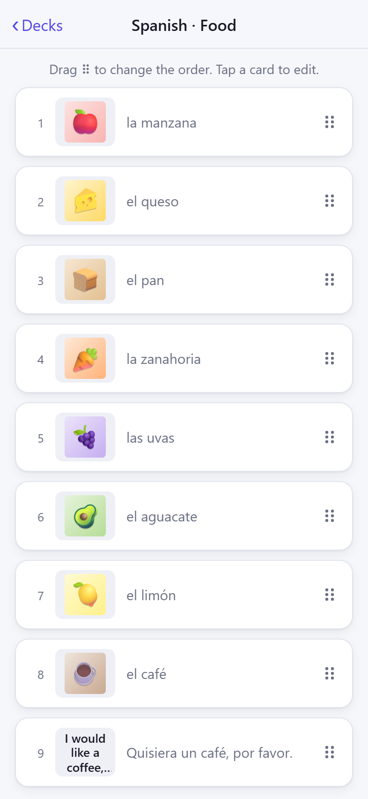
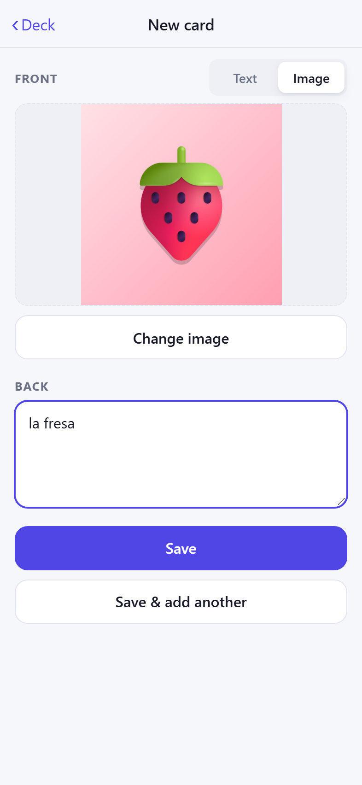
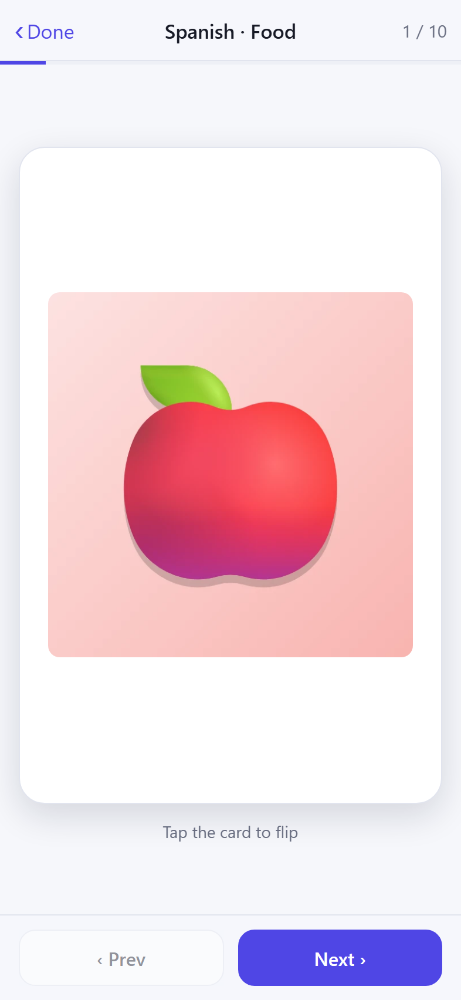
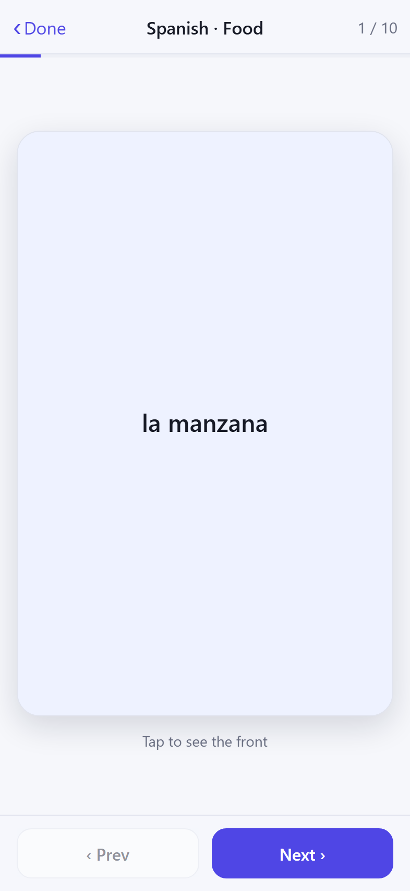
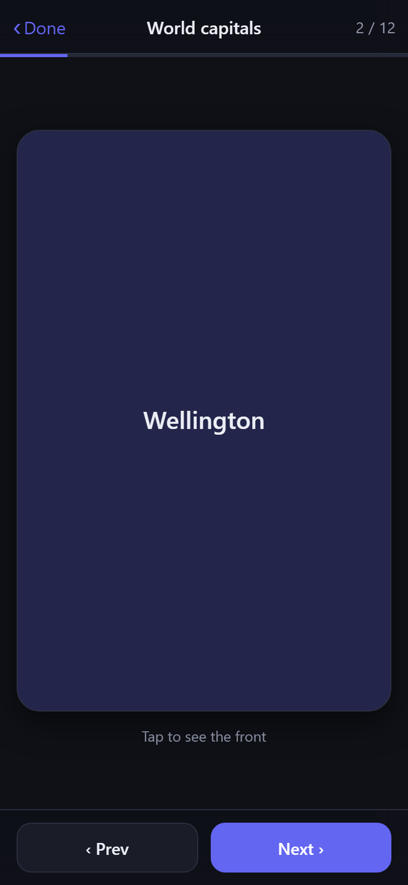

# MyWords

A flashcard app for your phone. Cards can have a photo on the front, taken with the camera or picked from your library.

**▶ Try it: [masonholland.github.io/MyWords](https://masonholland.github.io/MyWords/)**. Open it on your phone and add it to your home screen (Share → *Add to Home Screen*) to use it like an installed app. A native iOS version is planned.

<p align="center">
  
</p>
<p align="center"><sub><a href="docs/media/demo.mp4">Full-quality video (MP4)</a></sub></p>

## The problem

Paper flashcards get lost and are slow to make, especially if you want pictures on them. Most flashcard apps are built around typed text, and many want an account or a subscription.

## The solution

MyWords keeps your decks on your phone. Adding a picture card takes a photo and a word.

| Feature | What it does |
|---|---|
| **Decks** | Create, rename and delete decks. |
| **Cards** | The front is text or an image, the back is text. Images come from your photo library or the camera and are shrunk before saving. **Save & add another** keeps the editor open for the next card. |
| **Card order** | Drag a card's ⠿ handle to reorder the deck. On a phone, press briefly before dragging so the list still scrolls. |
| **Study** | Go through a deck in order or shuffled. Tap the card to flip it, Prev/Next to move. A progress bar shows where you are, and at the end you can restart, shuffle again or go back. Shuffling doesn't change the deck's saved order. |
| **Offline** | It's a Progressive Web App (PWA), so once it's on your home screen it opens full screen and works without signal. |

Everything is stored on the device. There's no account and no server.

## Screenshots

<table>
  <tr>
    <td align="center"><br><sub>Decks</sub></td>
    <td align="center"><br><sub>A deck of picture cards</sub></td>
    <td align="center"><br><sub>Adding a card</sub></td>
  </tr>
  <tr>
    <td align="center"><br><sub>Studying (front)</sub></td>
    <td align="center"><br><sub>Studying (back)</sub></td>
    <td align="center"><br><sub>Dark mode</sub></td>
  </tr>
</table>

## Tech stack

| Area | Choice |
|---|---|
| Language | [TypeScript](https://www.typescriptlang.org/) |
| UI | [React 19](https://react.dev/) with [React Router](https://reactrouter.com/) (hash routing, so it works on any static host) |
| Build tool | [Vite](https://vite.dev/) |
| Offline / install | [vite-plugin-pwa](https://vite-pwa-org.netlify.app/) (service worker and web app manifest) |
| Local database | IndexedDB via [Dexie](https://dexie.org/), with `dexie-react-hooks` for live queries |
| Drag & drop | [dnd-kit](https://dndkit.com/) (`core`, `sortable`, `modifiers`), with touch support |
| Styling | Plain CSS with custom properties: mobile-first, light/dark themes, safe-area aware |
| Unit tests | [Vitest](https://vitest.dev/) |
| README media | [Playwright](https://playwright.dev/) and [ffmpeg-static](https://github.com/eugeneware/ffmpeg-static) (`npm run media`) |

## Run it locally

### Prerequisites

- **[Node.js](https://nodejs.org/) 26 LTS** (includes npm). Check with `node -v`. The version is pinned in `.nvmrc`. Node 20 or newer also works.
- **[Git](https://git-scm.com/)** to download the code.

### 1. Download

```bash
git clone https://github.com/MasonHolland/MyWords.git
cd MyWords
```

Without Git, download the ZIP from the [repository page](https://github.com/MasonHolland/MyWords) (**Code → Download ZIP**), unzip it, and open a terminal in that folder.

### 2. Install dependencies

```bash
npm install
```

### 3. Start the app

```bash
npm run dev
```

Open **http://localhost:5180**. To get a phone-sized view on a desktop browser, open the developer tools (F12) and turn on device mode.

### 4. (Optional) Try it on your phone

1. Connect your phone to the same Wi-Fi as your computer.
2. Open the **Network** address Vite prints, e.g. `http://192.168.x.x:5180`.

Everything works on that address except offline mode, which needs HTTPS. If the page doesn't load, allow Node.js through your computer's firewall for private networks.

### Other commands

| Command | What it does |
|---|---|
| `npm run build` | Type-check and build the production app into `dist/` |
| `npm run preview` | Serve the production build at http://localhost:5181 |
| `npm test` | Run the unit tests (Vitest) |
| `npm run media` | Re-record the screenshots and demo video in `docs/media/` (see below) |
| `node scripts/make-icons.mjs` | Regenerate the PNG app icons in `public/` |

## Deploy

Every push to `main` runs the tests, builds the app and publishes it to GitHub Pages (`.github/workflows/deploy.yml`). In a fork, go to **Settings → Pages** and set **Source** to **GitHub Actions**.

`dist/` is a plain static site, so [Cloudflare Pages](https://pages.cloudflare.com/) or [Netlify](https://www.netlify.com/) work too (build command `npm run build`, output folder `dist`).

## Screenshots and demo video

`npm run media` records everything in `docs/media/` with Playwright in a phone-sized Chromium. It starts the dev server if it isn't already running, seeds a few sample decks in a fresh browser profile (your own decks aren't touched), and writes PNG screenshots, `demo.mp4`, `demo.gif` (used above) and `demo-poster.jpg`. Use `npm run media -- --only shots` or `--only video` to do half. The first time, run `npx playwright install chromium`.

The steps are in `scripts/media/capture.mjs`. If you change the UI, update the selectors there.

## Project structure

```
src/
  db.ts          Dexie schema and data helpers (decks, cards, ordering)
  pages/         DeckList, DeckDetail, CardEditor, Study
  components/    FlipCard, SortableCardRow, Sheet, TopBar, …
  lib/           shuffle, reorder, image resizing (pure helpers + tests)
  hooks/         useObjectUrl
  styles.css     All app styles
public/          Icons and static assets
scripts/         Icon generator; media/ records the README screenshots and video
docs/media/      Screenshots and demo video used in this README
```

Each card stores its position as `order`, which is why shuffling for study leaves the deck alone.

## Good to know

- **Your decks only exist in the browser you made them in.** There's no export or sync yet.
- **iPhone/iPad:** Safari may clear data for websites that aren't on the home screen. Add the app to your home screen to keep your decks.
